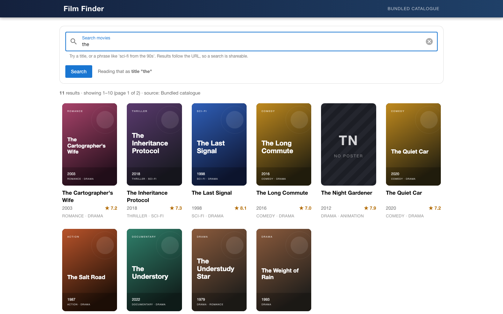
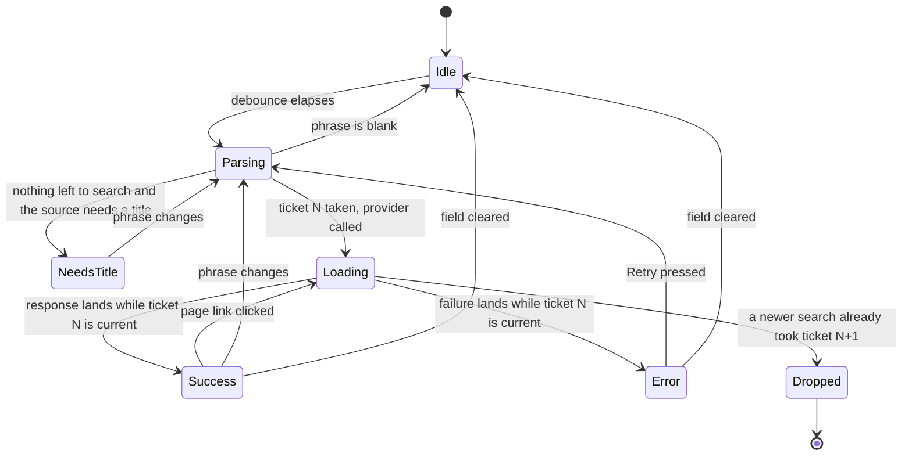
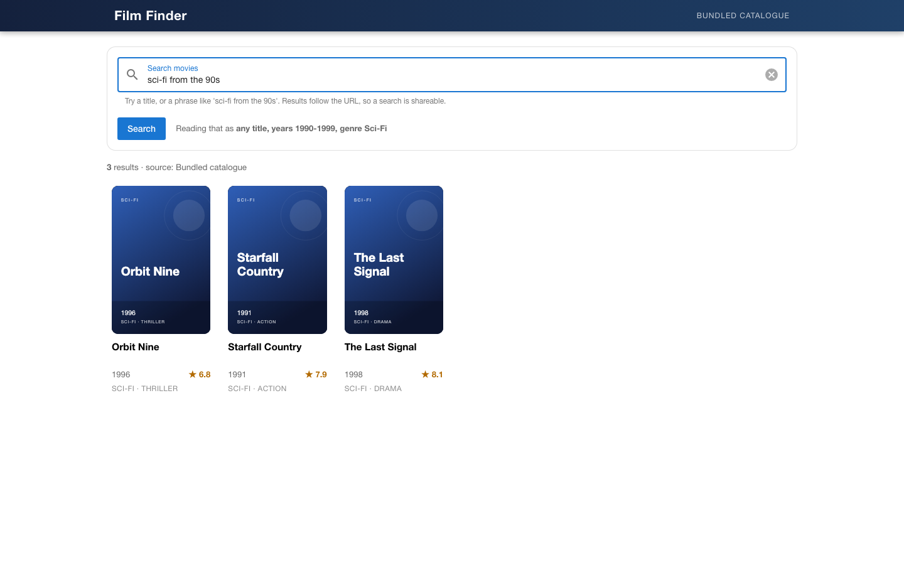
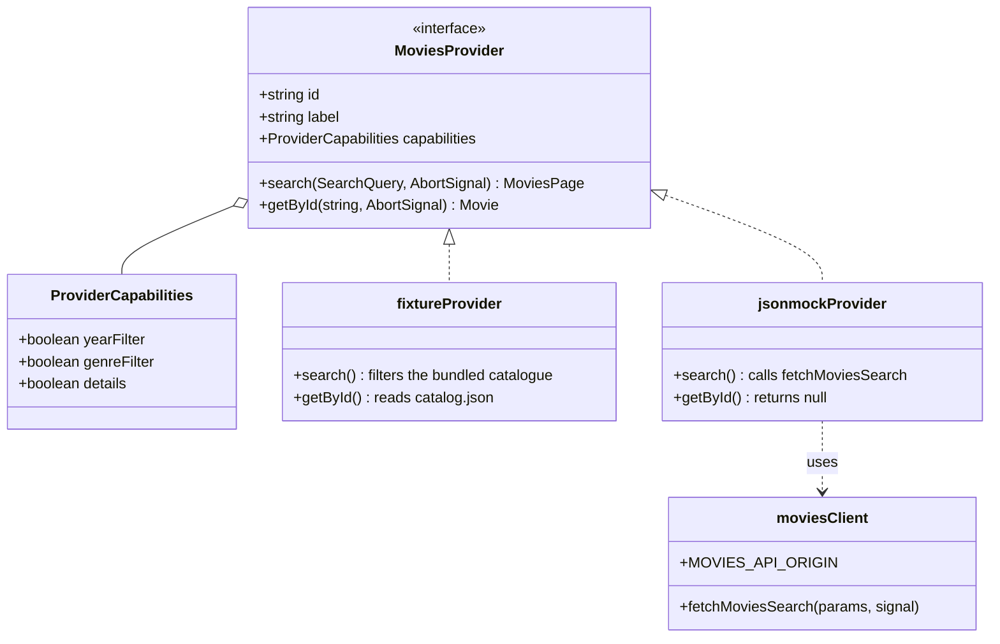
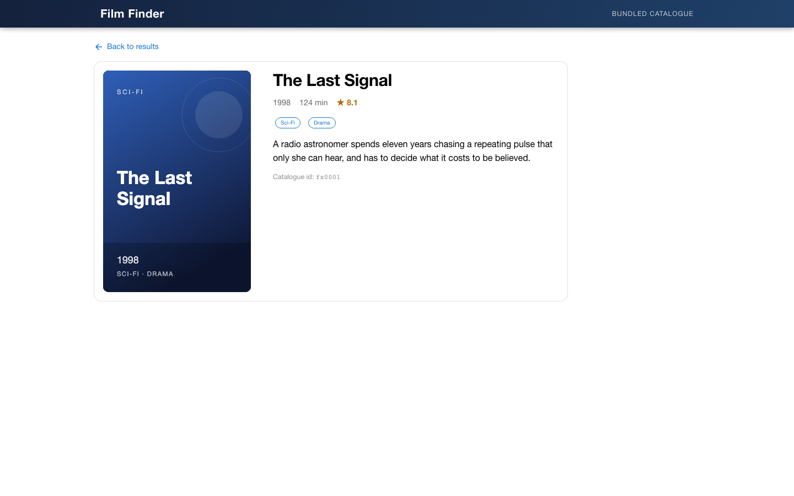

# Film Finder

A movie search screen built with Vue 3, Vite, TypeScript, Quasar and Pinia. Type a title, or
type a sentence — `sci-fi from the 90s` is parsed into a year range and a genre before anything
is fetched. The search lives in the URL, so a result page is a link you can send someone.



It ships with a bundled catalogue of 26 invented titles and 24 generated posters, so
`npm install && npm run dev` gives you a working app with **no API key and no network**. Point it
at the public HackerRank jsonmock endpoint with one environment variable when you want the real
thing.

---

## The life of one search

Between a keystroke and a rendered grid the store moves through a small state machine, and one
of its states exists purely to stop an abandoned request from repainting the screen.



`Parsing` is the phrase parser below. `Loading` calls whichever `MoviesProvider` the build is
configured with. The rest of the diagram is one rule.

The ticket matters. Aborting an `AbortController` cancels a request that is still in flight, but
it cannot cancel one whose `fetch` has already resolved — that one carries on into `.json()`, or
into a `503` throw, and lands after the newer request has already painted. So every call to
`run()` takes a number, and both the success path and the failure path refuse to touch the state
unless their number is still current. Two regression tests pin this down, one for a late success
and one for a late failure, in `src/stores/__tests__/moviesSearch.spec.ts`.

The URL being the source of truth has the same flavour of subtlety: opening `/?q=the&page=2`
fills the search box from the URL, which looks to the debounce exactly like typing. The debounced
callback therefore compares its value against the current query string and navigates only when
they differ, or a deep link would bounce back to page 1 after 350 ms. `e2e/search.spec.ts` waits
out the debounce and asserts the page number survives.

## Reading a phrase instead of a keyword

`src/ai/rulesQueryProvider.ts` turns free text into a `SearchQuery`. It is a rule parser: pure,
synchronous, offline, and exhaustively unit-tested.

| You type                                 | title             | years      | genres   |
| ---------------------------------------- | ----------------- | ---------- | -------- |
| `The Last Signal`                        | `the last signal` | –          | –        |
| `90s`                                    | –                 | 1990–1999  | –        |
| `eighties thriller`                      | –                 | 1980–1989  | Thriller |
| `2016 comedy`                            | –                 | 2016–2016  | Comedy   |
| `drama before 2000`                      | –                 | up to 1999 | Drama    |
| `sci-fi movies about space from the 90s` | `space`           | 1990–1999  | Sci-Fi   |

Filler words (`movies`, `about`, `from`, `the`, …) are stripped **only** once a year or a genre
has matched — otherwise `The Last Signal` would be mangled into `last signal`. The screen always
shows what it understood, so the interpretation is never a surprise:



This is the seam where a language model would go. `QueryUnderstandingProvider` has a second
implementation, `createRemoteQueryProvider`, which POSTs `{phrase}` to whatever URL you put in
`VITE_AI_QUERY_ENDPOINT` and expects `{title, yearFrom, yearTo, genres}` back. It validates the
answer — genres outside the catalogue and years outside 1900–2100 are discarded — and falls back
to the rule parser on a bad status, an unusable body, or a network failure. The variable is a
URL, not a key: a browser bundle is a public document, so the model credentials stay on the
service that answers the call. With the variable unset, the remote provider is never constructed.

## Where the movies come from



The two sources are not equally capable, and the app says so rather than quietly dropping what
you asked for:

|                            | bundled catalogue | HackerRank jsonmock |
| -------------------------- | ----------------- | ------------------- |
| search by title            | yes               | yes                 |
| filter by year             | yes               | no                  |
| filter by genre            | yes               | no                  |
| movie detail page          | yes               | no                  |
| posters, ratings, runtimes | yes               | not in the response |
| needs the network          | no                | yes                 |

Ask jsonmock for `alpha from the 90s` and you get a banner saying the release-year filter was not
applied. Ask it for `documentary` — a phrase with no title left after parsing — and it says it
needs a title, because that endpoint has no way to search without one. Adding a third source
(TMDB, OMDb, an internal service) is one file implementing `MoviesProvider` plus one line in
`src/api/providers/index.ts`.

The posters are SVGs generated from the catalogue itself by `npm run posters`, which keeps the
repo free of licensed artwork and of image hosts that might be down when you clone it. Two of the
26 entries deliberately have no poster, so the fallback tile is on screen in the default view
rather than only in a test.

## Run it

Node `^20.19.0 || >=22.12.0`.

```sh
npm install
npm run dev          # http://localhost:7211
```

That is the whole setup. No key, no `.env`, no network.

| Task                   | Command                       |
| ---------------------- | ----------------------------- |
| Dev server             | `npm run dev` (port 7211)     |
| Production build       | `npm run build`               |
| Preview the build      | `npm run preview` (port 7212) |
| Types                  | `npm run type-check`          |
| Lint (oxlint + ESLint) | `npm run lint`                |
| Format                 | `npm run format`              |
| Regenerate posters     | `npm run posters`             |

Copy `.env.example` to `.env` to change anything:

| Variable                 | Default   | Meaning                                                    |
| ------------------------ | --------- | ---------------------------------------------------------- |
| `VITE_MOVIES_PROVIDER`   | `fixture` | `fixture` or `jsonmock`                                    |
| `VITE_AI_QUERY_ENDPOINT` | empty     | server-side phrase parser, empty means use the rule parser |
| `VITE_DEVTOOLS`          | empty     | `1` mounts the Vue DevTools overlay                        |

These are read in exactly one place, `src/config/appConfig.ts`. Vite inlines `VITE_*` at build
time, so changing one means restarting the dev server or rebuilding the image.

To search the live endpoint instead:

```sh
VITE_MOVIES_PROVIDER=jsonmock npm run dev
```

## The test suites

```sh
npx playwright install chromium   # once
npm run test:unit                 # 78 tests in 9 files
npm run test:e2e                  # 16 tests
npm test                          # both
```

Observed on the last run: **78 unit tests passed**, **16 end-to-end tests passed**.

If Playwright reports `Executable doesn't exist`, the browser download was skipped — an
`ignore-scripts=true` in your npm config will do that silently. `npx playwright install chromium`
fixes it.

The end-to-end suite runs **two** dev servers, one per source, and each Playwright project talks
to its own:

- **`catalogue`** (port 7213, bundled source) — 12 tests over `e2e/search.spec.ts` and
  `e2e/detail.spec.ts`. These assert on real rendered data: poster `naturalWidth` is greater than
  zero, the fallback tile appears exactly once for `night`, `?q=the` reports 11 results across 2
  pages, back and forward work, an unknown id and an unknown route each render their own screen.
- **`jsonmock`** (port 7214, HTTP source) — 4 tests in `e2e/jsonmock-source.spec.ts`, with the
  endpoint stubbed by `page.route`. These cover the wire-format parsing, the skeleton and
  `aria-busy` while a request is held open, a 503 followed by a successful retry, and the
  ignored-filter banner.



## Container

```sh
docker compose up --build       # http://localhost:7211
```

Multi-stage: `node:22-alpine` builds, `nginxinc/nginx-unprivileged` serves the static output as
UID 101 on port 8080, with a read-only root filesystem and `no-new-privileges`. `docker/nginx.conf`
adds the history-mode fallback (`try_files $uri $uri/ /index.html`) that a Vue Router SPA needs,
plus long cache headers for the hashed assets and the posters. Because Vite inlines the source
choice at build time, it is a build argument:

```sh
docker compose build --build-arg VITE_MOVIES_PROVIDER=jsonmock
```

`docker compose config` parses. **The image has not been built or booted** — Docker was switched
off on the machine this was last worked on, so treat the Dockerfile as reviewed, not as verified.

## Files worth opening

| Path                                   | Why                                                  |
| -------------------------------------- | ---------------------------------------------------- |
| `src/stores/moviesSearch.ts`           | the request-ticket rule and the capability reporting |
| `src/ai/rulesQueryProvider.ts`         | the phrase parser                                    |
| `src/api/providers/types.ts`           | the interface a new catalogue implements             |
| `src/api/providers/fixtureProvider.ts` | `searchCatalog` is pure and totally ordered          |
| `src/composables/useDebouncedWatch.ts` | debounce with `cancel` and `flush`                   |
| `src/config/appConfig.ts`              | every tunable in the app                             |
| `scripts/generate-posters.mjs`         | how the artwork is produced                          |

## What is deliberately missing

- **No sorting control.** The bundled catalogue could sort by year or rating, but jsonmock
  cannot, and a control that silently changes meaning between sources is worse than no control.
- **No infinite scroll.** Numbered pages survive a refresh and a shared link — infinite scroll
  would undo the URL work above.
- **No favourites or watchlist.** That needs a place to put them, and there is no backend here.
- **One browser.** `playwright.config.ts` runs Chromium only — the projects are already doubled
  by source, and tripling them again by browser buys little here.
- **The remote phrase parser has no reference server.** Its client, validation and fallback are
  tested against a stubbed `fetch`, but no endpoint implementation ships here.

The current Quasar patch is verified by 78 unit tests and 16 Chromium browser
checks, including search, pagination, movie details and the HTTP catalogue adapter.
The HTTP adapter tests intercept requests locally; they do not rely on an external
catalogue staying online. GitHub runs the same checks on Node.js 22.

## Author

[**Muhammad Nadeem**](https://github.com/dev-mnadeem)
